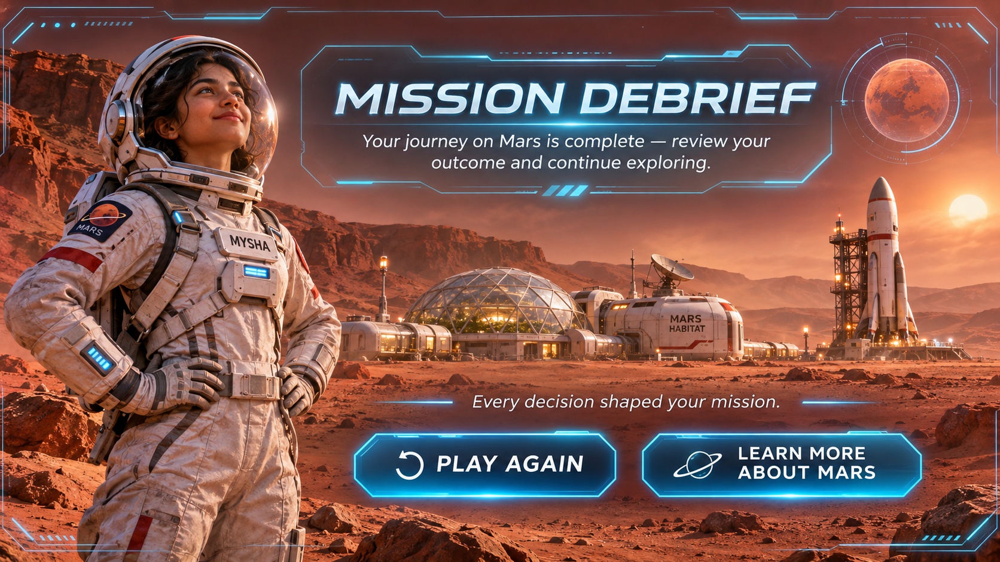
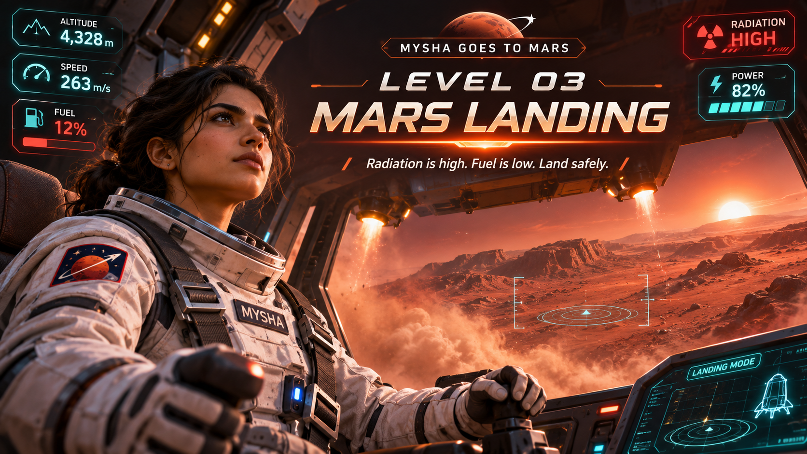
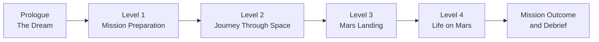
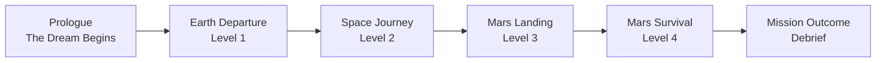
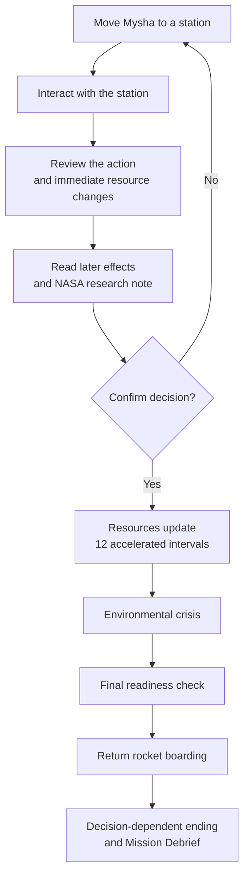
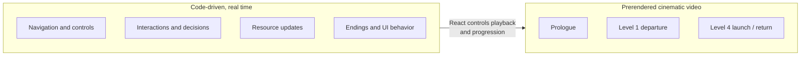
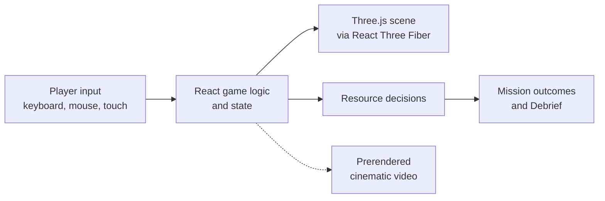

<div align="center">



<br />

# 🚀 MYSHA GOES TO MARS

### *An Interactive, AI-Assisted Educational Journey to the Red Planet*

**One dream. Four missions. A thousand decisions between Earth and Mars.**

A cinematic, story-driven, third-person 3D browser game where you guide Mysha from an early dream of Mars to a survival mission on the Martian surface. Every decision changes the mission.

<br />

[](https://mysha-goes-to-mars.vercel.app/)
[](#ai)
[](#overview)

[](https://react.dev/)
[](https://www.typescriptlang.org/)
[](https://threejs.org/)
[](https://vite.dev/)
[](https://mysha-goes-to-mars.vercel.app/)


<br />

**[▶ Play the Game](https://mysha-goes-to-mars.vercel.app/)** &nbsp;·&nbsp;
**[💻 Source Code](https://github.com/Shihab-10/mysha-goes-to-mars)** &nbsp;·&nbsp;
**[🧭 Gameplay Overview](#journey)** &nbsp;·&nbsp;
**[🤖 AI Transparency](#ai)** &nbsp;·&nbsp;
**[📚 NASA References](docs/NASA_DATA_SOURCES.md)**

</div>

> **⚠️ Independent project.** This is an independent educational game. It is **not affiliated with or endorsed by NASA**. Mission mechanics are **fictional**, and the science panels point to real NASA research. See [Inspired by NASA Research](#science).

<details>
<summary><b>🗺️ Table of contents</b></summary>

<br />

[Overview](#overview) · [Preview](#preview) · [Key Features](#features) · [The Journey](#journey) · [Level 4](#level-4) · [Controls](#controls) · [Cinematic Storytelling](#cinematics) · [How AI Was Used](#ai) · [Prompt Engineering](#prompts) · [NASA Research](#science) · [Technology Stack](#stack) · [Architecture](#architecture) · [Run Locally](#run-locally) · [Live Demo & Deployment](#deployment) · [Innovation & Impact](#impact) · [Limitations & Roadmap](#limits) · [Credits](#credits)

</details>

---

<a id="overview"></a>
## 🌌 Project Overview

> **The central idea:** What if learning about a mission to Mars felt like *being responsible for one*? Instead of only watching a video or reading facts, players explore, make decisions, face trade-offs, and discover the scientific reasoning behind their choices.

| | |
|---|---|
| **Project** | Mysha Goes to Mars |
| **Category** | Educational interactive 3D adventure / science storytelling |
| **Context** | Created as a NASA Space Apps Challenge project |
| **Gameplay** | Single-player, third-person, decision-driven browser experience |
| **Story structure** | Prologue + four playable levels + branching finale |
| **Primary platform** | Desktop web; responsive interfaces and touch-friendly controls where implemented |
| **Live game** | [mysha-goes-to-mars.vercel.app](https://mysha-goes-to-mars.vercel.app/) |
| **Repository** | [github.com/Shihab-10/mysha-goes-to-mars](https://github.com/Shihab-10/mysha-goes-to-mars) |
| **Scientific approach** | NASA-referenced educational explanations + clearly identified fictional simulation mechanics |
| **AI disclosure** | [Detailed below](#ai) and in the [prompt log](docs/AI_PROMPT_LOG.md) |

### 🎯 The problem and our solution

**The problem:** Space science ideas such as life support, atmosphere, radiation, limited resources, orbital timing, and mission safety are hard to connect to real decisions through static explanations alone.

**Our solution:** A playable story. The player guides Mysha through mission preparation, an emergency in space, a landing, survival on Mars, and a possible return journey. Science context appears next to each decision, and the final outcome depends on how the mission was managed.

---

<a id="preview"></a>
## 🖼️ Preview

<table>
  <tr>
    <td width="50%" align="center">
      
      <br /><sub><b>Level 3 — Mars Landing</b><br />Cinematic scene artwork used in the interface.</sub>
    </td>
    <td width="50%" align="center">
      
      <br /><sub><b>Finale — Mission Debrief</b><br />AI-generated artwork with real, clickable React button regions.</sub>
    </td>
  </tr>
</table>

> 📌 These are artwork images used in the game interface. Live gameplay screenshots or a GIF are a proposed future addition (see [Roadmap](#limits)).

### Mission flow at a glance



---

<a id="features"></a>
## ✨ Key Features

| | Feature | What it means |
|---|---|---|
| 🎮 | **Playable 3D world** | Move Mysha, explore scenes, approach stations, and interact with equipment. |
| 🧠 | **Decisions with consequences** | Food, water, power, shelter, radiation risk, life support, and rocket readiness interact through game rules. |
| 🎬 | **Hybrid cinematics** | Selected story moments use generated video. Exploration and interactions stay code-driven. |
| 🏁 | **Four possible outcomes** | There is no guaranteed happy ending. |
| 📚 | **Mars Discovery Archive** | Topic-based science explanations and links to NASA resources after the finale. |
| 🔬 | **Science with honesty** | Real research is referenced. Game numbers are clearly labeled as fictional. |
| 🤖 | **Transparent AI use** | Every AI use is documented, including what is not verified. |

**What makes the experience different**

- **Story and gameplay are connected:** the journey gives each task a reason to exist.
- **Learning continues after the finale:** the Mars Discovery Archive explains the science behind the mission.
- **Honest design:** fictional mechanics and real NASA references are kept clearly apart.

---

<a id="journey"></a>
## 🧭 The Journey — From Earth to Mars



| Chapter | Player's experience | Learning focus |
|---|---|---|
| **Prologue — The Dream Begins** | Meet Mysha and discover why she wants to explore Mars. | Inspiration, exploration, and scientific curiosity. |
| **Level 1 — Mission Preparation and Departure** | Explore the mission facility, verify essential supplies, prepare for launch, and watch the departure cinematic. | Checklists, equipment, planning, and mission readiness. |
| **Level 2 — The Journey Through Space** | Respond to an oxygen / life-support emergency during the trip. | Oxygen management, power, system repairs, and decisions under pressure. |
| **Level 3 — Landing on Mars** | Manage the approach, allocate mission resources, and complete the landing sequence. | Landing constraints, trade-offs, and planning for survival. |
| **Level 4 — Life on Mars: The Survival Window** | Explore a Mars base, maintain critical systems, prepare the return rocket, and respond to environmental hazards. | Water recycling, food production, radiation, electricity, crew safety, and return readiness. |
| **Finale — Mission Debrief** | Review the outcome, explore the Mission Log, play again, or learn more about Mars. | Cause and effect, reflection, and science communication. |

**🌍 → 🚀 → 🪐 → 🏠 → 🌎**

> The game follows Mysha's **fictional** journey. It is **not** a claim that humans have already landed on Mars.

---

<a id="level-4"></a>
## 🧑‍🚀 Level 4 — Life on Mars: The Survival Window

**Level 4 is the core decision-making experience.** It is more than collecting objects. The player keeps a Mars base running while preparing a safe return.

> ### Every decision changes the mission.

### What the player does

- Moves Mysha through an interactive 3D Mars base.
- Visits six research and survival stations.
- Reviews each action's immediate and later effects before confirming it.
- Handles an environmental crisis.
- Completes a final readiness check and boards the return rocket.
- Receives one of four decision-dependent endings, then a Mission Debrief.

### Six interactive workstations

| Station | What the player does | Why it matters |
|---|---|---|
| 🏠 **Living Habitat** | Maintains life-support reliability. | A pressurized, controlled environment is essential. |
| 🌱 **Hydroponics Lab** | Supports crop production and food supply. | Food depends on water, power, and sustained operations. |
| 💧 **Water Recycling** | Maintains water recovery systems. | Water is scarce and expensive to transport. |
| 🛡️ **Radiation Shelter** | Improves protection and manages exposure risk. | Mars has a thin atmosphere and limited natural shielding. |
| ☀️ **Solar Power Station** | Maintains panels and electrical generation. | Dust and power shortages affect nearly everything. |
| 🚀 **Return Rocket Bay** | Improves return-vehicle readiness. | A return attempt needs a prepared vehicle *and* enough resources. |

### Preparing the rocket vs. boarding it

These are two different steps:

| Step | Where | What happens |
|---|---|---|
| **Preparing** | Return Rocket Bay station, during the mission | The player improves return-vehicle readiness through decisions. |
| **Boarding** | End of the mission, after the crisis and final readiness check | The player approaches the return rocket for the final boarding sequence. The ending depends on earlier decisions. |

### How a decision works



**Possible results:** `Mission Successful` · `Partial Success` · `Mission Compromised` · `Mission Failed`

> **Scientific integrity:** The 12 intervals, Sol progression, percentage meters, resource deltas, readiness thresholds, hazard scores, and ending calculations are **fictional, educational gameplay mechanics**. They are **not measurements or limits taken from NASA**. The science panels refer to real research, but the game does not claim to process live NASA telemetry.

---

<a id="controls"></a>
## 🕹️ Controls

| Action | Desktop controls |
|---|---|
| Move | `W` `A` `S` `D` or arrow keys |
| Run | `Shift` (where available) |
| Interact with objects / stations | `E` |
| Rotate / explore camera | Mouse drag / in-game camera controls |
| Additional information | In-game HUD, Map, Science, and Help panels |
| Mobile / touch | Available on-screen controls in supported scenes |

> Controls and responsiveness vary by scene. For the best 3D experience, start on a desktop browser.

---

<a id="cinematics"></a>
## 🎬 Cinematic Storytelling & Interactive Exploration

The game uses a **hybrid approach**:

| Real-time, code-driven | Prerendered cinematic video |
|---|---|
| Movement and camera | Prologue |
| Interactions with stations | Level 1 departure |
| Decisions and resource updates | Level 4 launch / return |
| Endings, UI, and the Mission Debrief | |



> **Important:** The videos are **AI-assisted prerendered footage**. They are **not** rendered live by Three.js and they are **not interactive 3D**. React, TypeScript, HTML, CSS, and Three.js code handle navigation, gameplay, resource updates, controls, endings, and UI behavior.

### Cinematic files

GitHub does not reliably play embedded video inside a README, so the files are linked here instead. Open a link to view the file in the repository.

| Cinematic | File | Role |
|---|---|---|
| Prologue | [`public/videos/mysha-prologue.mp4`](public/videos/mysha-prologue.mp4) | Story introduction |
| Level 1 departure | [`public/videos/level1/level1-departure.mp4`](public/videos/level1/level1-departure.mp4) | Departure cinematic; playback and progression controlled in React |
| Level 4 launch / return | [`public/videos/level4/level4-launch.mp4`](public/videos/level4/level4-launch.mp4) | Multi-shot launch cinematic tied to the decision-dependent ending flow |

### Other media assets

| Asset | Role | Disclosure |
|---|---|---|
| `public/models/characters/Meshy_AI_Animation_Walking_withSkin.fbx` | Mysha's character / animation asset | Existing FBX asset integrated into the project. This README does not assert a creation tool or license without verification. |
| `public/textures/characters/texture_0.png` | Character texturing | Used by the 3D character setup. |
| `public/images/level4/mars-mission-debrief.png` | Final mission-debrief composition | AI-generated image. Code adds real, accessible, clickable button regions. |
| `public/images/level3/level3-mars-landing.png` | Landing artwork | Cinematic scene artwork used in the interface. |

> **Media and credit note:** Generated and third-party assets must be reviewed for use permissions before redistribution beyond this project. A file name alone does **not** establish copyright, authorship, or license.

---

<a id="ai"></a>
## 🤖 How Artificial Intelligence Was Used

> **AI assisted with planning, creative ideation, image and video generation, code drafting, UI iteration, debugging, and documentation. The game was built through an iterative, developer-controlled workflow. No custom AI model was trained for this game.**

### Where AI helped

| | Area | How AI assisted (based on project records) | Developer's role |
|---|---|---|---|
| **A** | **Ideation and story development** | ChatGPT helped develop the game concept, missions, architecture, technical requirements, and detailed English prompts. | Defined the game goal, requested changes, and reviewed creative direction. |
| **B** | **UI / UX design** | Lovable was used for visual prototyping and landing-screen design exploration. | Selected and iterated on the cinematic design direction. |
| **C** | **Software development** | ChatGPT and Claude-assisted code drafting were used during level development, including Level 4. An Antigravity / VS Code coding-agent workflow helped with scaffolding and code tasks. | Supplied existing source, merged versions, ran builds, tested gameplay, and reported errors. |
| **D** | **Cinematic video generation** | An AI video-generation workflow produced video segments for story and launch sequences. **Provider not verified in the preserved record.** | Directed shots and continuity, supplied prompts, organized MP4 files, and integrated playback. |
| **E** | **Visual asset generation** | AI image generation helped create Mars-themed artwork, including the final Mission Debrief image. | Requested composition and English text, selected and integrated assets. |
| **F** | **Testing and refinement** | AI assisted with error investigation, source-code revisions, Git instructions, and Vercel deployment guidance. | Ran the real commands, committed code, pushed to GitHub, deployed, and manually tested results. |
| | **NASA educational content** | AI helped summarize and present official science references in game-friendly language. | Supplied and reviewed reference sources and asked for clear separation from fictional game data. |

### AI tools and responsibilities

| AI tool | How it was used | Type of contribution |
|---|---|---|
| **ChatGPT** | Concept, missions, architecture, technical requirements, English prompts, and code drafting | Planning and code drafting |
| **Claude** | Code drafting during level development, including Level 4 | Code drafting and revision |
| **Lovable** | Visual prototyping and landing-screen design exploration | UI design exploration |
| **Antigravity / VS Code coding-agent workflow** | Project scaffolding and code-related tasks in the local workspace | Setup and coding assistance |
| **AI image generator — tool not verified** | Mars-themed artwork, including the Mission Debrief image | Visual assets |
| **AI video generator — provider not verified** | Cinematic segments for story and launch sequences | Cinematic footage |

### Human role and boundaries

- A human defined the project goal, chose and integrated assets, merged code versions, ran builds, tested gameplay, committed to Git, and deployed.
- **No claim** of an AI model trained specifically for this game.
- **No claim** that AI-generated code was automatically correct. Build and runtime checks matter.
- **No claim** that AI completed or independently validated the project.
- **No claim** that the fictional story or outcomes are NASA forecasts.
- **No claim** of a live data feed or official mission-control access.

---

<a id="prompts"></a>
## ✍️ AI Prompt Engineering & Development Workflow

📄 **[View the Complete AI Prompt Log](docs/AI_PROMPT_LOG.md)**

### How prompts were used

1. **Define the goal** in clear English, including what *not* to do (for example: "Do not create a new website").
2. **Add technical limits**: React, TypeScript, Three.js, React Three Fiber, Drei, third-person control, responsive UI.
3. **Add science rules**: never label fictional numbers as NASA measurements.
4. **Run and review**: the developer ran builds, tested the game, and reported errors.
5. **Iterate**: later prompts upgraded existing levels (for example, fixing walking jitter) instead of starting over.

### Prompt provenance

| Label | Meaning |
|---|---|
| **Verified excerpt** | Exact text from a retained project transcript. |
| **Documented excerpt** | A selected excerpt of a longer prompt drafted during development. |
| **Reconstructed Prompt — Representative Example** | Written from recorded design goals. It shows the original *intent*. It is **not** a word-for-word copy of what was submitted. |

> The exact wording of the video-generator and AI-agent chats is not available. The prompts below are a curated set, not a full chat export.

<details>
<summary><strong>Prompt 01 — Project architecture and environment setup (verified excerpt)</strong></summary>

```text
Act as a senior web-based 3D game architect, React/TypeScript engineer,
and technical setup assistant.

Your assignment is to prepare the COMPLETE DEVELOPMENT FOUNDATION
for a new cinematic, story-driven, interactive 3D browser game titled:
MYSHA GOES TO MARS.

This project is being developed for the NASA Space Apps Challenge.

YOUR CURRENT MISSION IS PROJECT INITIALIZATION, ARCHITECTURE,
PACKAGE INSTALLATION, FILE SCAFFOLDING, AND ENVIRONMENT
VERIFICATION ONLY.

Do not attempt to build the full game in this phase.
```

**Evidence:** Exact excerpt from the retained `PHASE 0 — COMPLETE PROFESSIONAL PROJECT ARCHITECTURE & ENVIRONMENT SETUP` prompt.

</details>

<details>
<summary><strong>Prompt 02 — Cinematic third-person gameplay (Reconstructed Prompt — Representative Example)</strong></summary>

```text
Build an original cinematic browser-based 3D adventure, not a static landing page.
Use React, TypeScript, Three.js, React Three Fiber and Drei.
Make Mysha a controllable third-person character with smooth camera-follow,
walking and interaction controls. Preserve a coherent story across four levels.
Use real-time 3D for exploration and interactions; use prerendered video only
for deliberately cinematic moments. Make the interface responsive.
```

</details>

<details>
<summary><strong>Prompt 03 — Level 2 oxygen crisis (Reconstructed Prompt — Representative Example)</strong></summary>

```text
Create an interactive spacecraft oxygen emergency for Level 2.
The player should identify the malfunction, make meaningful decisions,
repair relevant equipment and protect life support.
Keep the scene cinematic but actually playable, preserve mission progression,
and explain the scientific reasoning in beginner-friendly language.
```

</details>

<details>
<summary><strong>Prompt 04 — Level 3 Mars landing (Reconstructed Prompt — Representative Example)</strong></summary>

```text
Design Level 3 as an interactive Mars landing sequence.
Allow the player to allocate 100 mission resource points across competing
priorities, then complete the landing experience with cinematic transitions.
Carry the resource allocation into Level 4. Do not duplicate the landing
or jump straight to the next level without the intended progression.
```

</details>

<details>
<summary><strong>Prompt 05 — Level 4 survival simulation (Reconstructed Prompt — Representative Example)</strong></summary>

```text
Create Level 4: LIFE ON MARS — THE SURVIVAL WINDOW.
Keep the third-person character and six interactive Mars-base workstations.
Each action must affect realistic categories of fictional game resources:
food, water, power, life support, radiation protection, and rocket readiness.
Add a tutorial, a timed mission structure, a solar/dust crisis, a final
rocket boarding interaction, and four decision-dependent outcomes.
Include a source-linked NASA Science Library. Never label fictional
percentages or risk scores as actual NASA measurements.
```

</details>

<details>
<summary><strong>Prompt 06 — Three-part Mars departure video (Reconstructed Prompt — Representative Example)</strong></summary>

```text
Create three visually consistent 10-second cinematic clips in 16:9.
Part 1: Mysha approaches the Mars return rocket and enters the spacecraft.
Part 2: Show the cockpit, safety checks, countdown, and engine ignition.
Part 3: Show the rocket departing the Martian surface and ascending into space.
Preserve the same Mysha character, astronaut suit, spacecraft design,
Mars lighting, and visual continuity across every clip.
End before revealing the player's mission outcome.
```

</details>

<details>
<summary><strong>Prompt 07 — Level 4 refinement and animation-jitter repair (documented excerpt)</strong></summary>

```text
Your mission is to upgrade my EXISTING Level 4 into a much more cinematic,
smooth, realistic-looking, responsive and interactive experience.
Do not create a new website. Do not create a new game project.
Do not discard existing gameplay.
Fix Mysha's walking jitter at its actual source.
Keep animation, character movement and camera updates synchronized.
Preserve the rocket boarding, launch video and all four endings.
```

This is a selected excerpt of a longer refinement master prompt drafted during development.

</details>

<details>
<summary><strong>Prompt 08 — Final interactive Mars Mission Debrief (Reconstructed Prompt — Representative Example)</strong></summary>

```text
Use the supplied Mars Mission Debrief artwork as the final screen after
all four mission outcomes and the Mission Log.
Do not replace the image with another design.
Make PLAY AGAIN and LEARN MORE ABOUT MARS genuinely clickable React buttons.
PLAY AGAIN should start the full story from Level 1 through the parent game route.
LEARN MORE should open a beautiful Mars Discovery Archive with ten NASA-backed
science topics, typewriter text, pause/skip controls, animated visuals,
accessible navigation and responsive mobile layouts.
Preserve the game's existing story and state management.
```

</details>

### 🎥 AI video prompt engineering

The Level 4 launch cinematic was planned as **three clips of about 10 seconds each**, joined into a cutscene of roughly 30 seconds:

| Part | Planned content |
|---|---|
| **Part 1** | Approach and boarding of the return rocket |
| **Part 2** | Cockpit, safety checks, countdown, and ignition |
| **Part 3** | Rocket departing the Martian surface |

Prompt design focused on:

- **Character consistency:** same Mysha, suit, and spacecraft in every clip.
- **Environment continuity:** the same Mars lighting across clips.
- **16:9 format** and clip sequencing.
- **Story continuity:** the clips end *before* the mission outcome is shown, so the decision-dependent ending stays in code.

> These are planned sequence stages. The specific video-generation provider is **not recorded** in the available history, so none is credited. Full prompts are in the [prompt log](docs/AI_PROMPT_LOG.md).

---

<a id="science"></a>
## 🔬 Inspired by NASA Research

> **This is an independent educational game and is not affiliated with or endorsed by NASA.** NASA and mission names are used for attribution and scientific reference only.

| | Real scientific research | Fictional educational gameplay |
|---|---|---|
| **What it is** | NASA and JPL public educational materials | Percentages, resource changes, thresholds, hazard scores, intervals, Sol progression, and endings |
| **Where it appears** | Science panels, research notes, Mars Discovery Archive | Level 4 meters, decisions, and results |
| **Claim made** | Referenced and linked | **Not** NASA data. **Not** NASA limits |

Topics covered: Mars exploration, environmental observations, life-support systems, space radiation, astronaut safety, water recovery, plant research, and human spaceflight challenges.

| NASA / JPL resource | Relevant subject | Use in this game |
|---|---|---|
| [NASA Mars](https://science.nasa.gov/mars/) | Planetary overview and exploration | Mars facts and educational archive. |
| [NASA-STD-3001](https://www.nasa.gov/ochmo/human-spaceflight-and-aviation-standards) | Crew health / human systems | Discussion of astronaut safety and design considerations. |
| [NASA ECLSS](https://www.nasa.gov/missions/station/iss-research/nasas-2023-space-station-achievements/) | Environmental control and life support | Water-recovery and life-support context. **ISS experience, not a proven Mars base.** |
| [MSL Curiosity — RAD](https://data.nasa.gov/dataset/mars-science-laboratory-msl-radiation-assessment-detector-rad-level-2-observation-dosimetr-e2695) | Radiation measurements | Radiation education and hazard explanation. |
| [Perseverance — MEDA](https://science.nasa.gov/mission/mars-2020-perseverance/science-instruments/) | Martian weather and dust | Environmental storytelling and Mars weather context. |
| [NASA Growing Plants in Space](https://www.nasa.gov/exploration-research-and-technology/growing-plants-in-space/) | Space agriculture | Hydroponics and plant-growth learning topics. |
| [JPL Mars 2020 Landing](https://www.jpl.nasa.gov/news/press_kits/mars_2020/landing/) | Rover landing context | Landing-story inspiration and mission terminology. |
| [NASA: Rendezvous with Mars](https://www.nasa.gov/podcasts/houston-we-have-a-podcast/rendezvous-with-mars/) | Earth–Mars transfer opportunities | Explaining why return planning involves orbital timing. |

**What is and is not integrated:** NASA references and explanatory content are included in the game. The repository is **not** a downloaded, cleaned, or live-connected RAD/MEDA dataset pipeline. Original data tables, real-time sensor feeds, and official NASA numerical validation are **not** claimed.

Full source list: [NASA source manifest](docs/NASA_DATA_SOURCES.md)

---

<a id="stack"></a>
## 🏗️ Technology Stack

[](https://react.dev/)
[](https://www.typescriptlang.org/)
[](https://vite.dev/)
[](https://threejs.org/)
[](https://git-scm.com/)
[](https://github.com/Shihab-10/mysha-goes-to-mars)

| Area | Technology |
|---|---|
| Web application | React 19, TypeScript 5, Vite 8 |
| 3D world / rendering | Three.js, React Three Fiber, Drei |
| Character assets / animations | FBX asset pipeline, Three.js animation system |
| Interface | React components, HTML, CSS, Lucide React |
| Quality tools | ESLint, Prettier, TypeScript, Vitest, Testing Library |
| Libraries installed and available | React Three Rapier / Rapier (physics), Zustand and GSAP (state and effects), Howler.js (audio) |
| Version control | Git + GitHub |
| **Deployment service** | **Vercel** (hosting, separate from the development stack) |

> *Note:* Some packages are installed as part of the architecture. Installation does not mean every package is actively used in every level.

**Why this stack fits a browser 3D game:** React organizes the interface and game state, TypeScript catches mistakes early, Vite gives fast builds, and Three.js with React Three Fiber renders 3D scenes in the browser with no plugin. Players need only a WebGL-capable browser.

---

<a id="architecture"></a>
## 🧩 Software Architecture

This is a **front-end only** project, deployed as a static site. No backend, database, login system, or AI inference API is described in the project documentation.



> *Conceptual diagram. It simplifies the real implementation.*

<details>
<summary><b>📁 Key files and folders</b></summary>

<br />

```text
mysha-goes-to-mars/
├── public/
│   ├── images/                  # Cinematic artwork and debrief image
│   ├── models/characters/       # Mysha FBX character asset
│   ├── textures/characters/     # Character textures
│   └── videos/                  # Prologue, Level 1 and Level 4 MP4s
├── src/
│   ├── App.tsx                  # Story/entry experience
│   ├── app/
│   │   ├── GameShell.tsx        # Early playable mission shell
│   │   ├── Level1DepartureCinematic.tsx
│   │   ├── Level2Journey.tsx
│   │   ├── Level3Landing.tsx
│   │   ├── Level3With4.tsx      # Level 3 → Level 4 bridge
│   │   ├── Level4Mars.tsx       # Mars survival and final debrief
│   │   └── MissionMusic.ts
│   ├── game/                    # Shared and scaffolded game modules
│   ├── data/                    # Story and NASA source manifests
│   └── styles/                  # Global and game styles
├── docs/
│   ├── AI_PROMPT_LOG.md         # AI use, actual prompt provenance and examples
│   ├── NASA_DATA_SOURCES.md
│   └── ARCHITECTURE.md
├── tests/
├── package.json
├── vite.config.ts
└── README.md
```

</details>

---

<a id="run-locally"></a>
## 💻 Run Locally

**Requirements:** a recent Node.js version (check which Node releases your Vite version supports), npm, and a browser with WebGL support. A specific Node version is not documented in this project.

```bash
# 1. Clone the repository
git clone https://github.com/Shihab-10/mysha-goes-to-mars.git
cd mysha-goes-to-mars

# 2. Install dependencies
npm install

# 3. Start the development server
npm run dev
```

Open the local URL that Vite prints in the terminal (for example, a `localhost` address).

### Build and checks

```bash
npm run build       # TypeScript build + Vite production build
npm run preview     # Preview the built site locally
npm run typecheck   # TypeScript checks
npm run lint        # ESLint
npm run test        # Vitest
```

**Observed validation:** a Windows production build using `tsc -b && vite build` completed successfully with **582 transformed modules** (November 2026). Vite showed a **large JavaScript chunk warning**, not a build failure. This README does **not** claim a full end-to-end automated gameplay test or support for every device.

---

<a id="deployment"></a>
## 🚀 Live Demo & Deployment

| | |
|---|---|
| **▶ Live game (public deployment)** | https://mysha-goes-to-mars.vercel.app/ |
| **💻 GitHub repository** | https://github.com/Shihab-10/mysha-goes-to-mars |

The Vite build is deployed as a static front end on **Vercel** from the GitHub repository.

| Vercel setting | Value |
|---|---|
| Framework preset | Vite |
| Root directory | `./` |
| Build command | `npm run build` |
| Output directory | `dist` |
| Install command | `npm install` |

Files in `public/` become root-relative URLs. For example:

`public/videos/level1/level1-departure.mp4` → `/videos/level1/level1-departure.mp4`

> **Media tip:** If a cinematic does not start in the game, open its direct public URL first. A working direct MP4 URL and a failing in-game check are two different problems. Browsers can also block autoplay or audio.

> Full testing on all browsers and devices has **not** been completed. See [Limitations](#limits).

---

<a id="impact"></a>
## 🌍 Innovation & Educational Value

| Idea | What the project shows |
|---|---|
| **Interactive educational storytelling** | A character-driven story gives each science idea a reason to appear. |
| **Science-informed decisions** | Each station action shows its effects and a related NASA research note. |
| **Gamified Mars exploration** | Players manage food, water, power, shelter, radiation risk, and rocket readiness together. |
| **Multiple endings** | Four outcomes are shaped by player choices. |
| **Integrated cinematics** | Prerendered video connects story moments to real-time play. |
| **Browser-accessible 3D** | Playable from a link, with no install. |
| **Transparent AI-assisted development** | Tools, roles, and unknowns are documented openly. |
| **Learning after the game** | The Mars Discovery Archive offers topic-based science explanations. |

---

<a id="limits"></a>
## 🧪 Limitations & Roadmap

### Known limitations

- Game numbers (meters, thresholds, intervals, hazard scores) are **educational simplifications**, not NASA values.
- Cinematics are **prerendered AI-assisted video**, not live 3D.
- 3D performance depends on the device. Vite reports a large JavaScript chunk.
- The full Level 1 → Level 4 route has not been verified on all browsers and devices.
- No complete automated gameplay test or accessibility audit is claimed.
- The video and image generation providers are not recorded.
- Asset licenses (character model, generated media) are not verified.

### Next steps

- [ ] Test the complete Level 1 → Level 4 route on deployed desktop and mobile browsers.
- [ ] Improve 3D performance, JavaScript code splitting, and loading progress for slower devices.
- [ ] Refine camera, character animation, and collision edge cases.
- [ ] Audit video availability checks and autoplay handling across browsers.
- [ ] Confirm every external science link before final judging and submission.
- [ ] Add more automated gameplay tests and accessibility testing.
- [ ] Improve source attribution for all third-party and AI-generated media assets.
- [ ] Add gameplay screenshots or a short GIF to this README *(proposed; no file exists yet)*.
- [ ] Add more science learning modules *(proposed)*.

---

## 📖 Documentation

| Document | Contents |
|---|---|
| **[AI prompts & disclosure](docs/AI_PROMPT_LOG.md)** | Exact saved Phase 0 prompt, development workflow, reconstructed English prompt examples, video prompts, and provenance. |
| **[NASA source manifest](docs/NASA_DATA_SOURCES.md)** | Research-source inventory. |
| **[Architecture overview](docs/ARCHITECTURE.md)** | Initial modular design. Some original scaffold notes may be outdated compared with the current playable build. |
| **[Project story](docs/GAME_STORY.md)** | Early narrative documentation. |

---

<a id="credits"></a>
## 🙌 Credits & Acknowledgments

**Project development:** [@Shihab-10](https://github.com/Shihab-10) — game direction, source integration, iteration, validation, repository and deployment workflow.

**Research references:** NASA and NASA JPL public educational materials (see linked citations above).

**Development assistance:** ChatGPT, Claude-assisted drafting, Antigravity / VS Code AI-agent workflow, Lovable visual prototyping, and AI image and video generation, as disclosed in [How Artificial Intelligence Was Used](#ai). Specific media-model attribution is left open where it is unavailable.

### 📄 License

No open-source license is declared in this repository at the time of this README. Public GitHub visibility does **not** automatically allow reuse of the game's code, videos, character assets, or artwork.

<div align="center">

---

### *The mission may end. Curiosity doesn't.*

**[▶ PLAY MYSHA GOES TO MARS](https://mysha-goes-to-mars.vercel.app/)**

</div>
